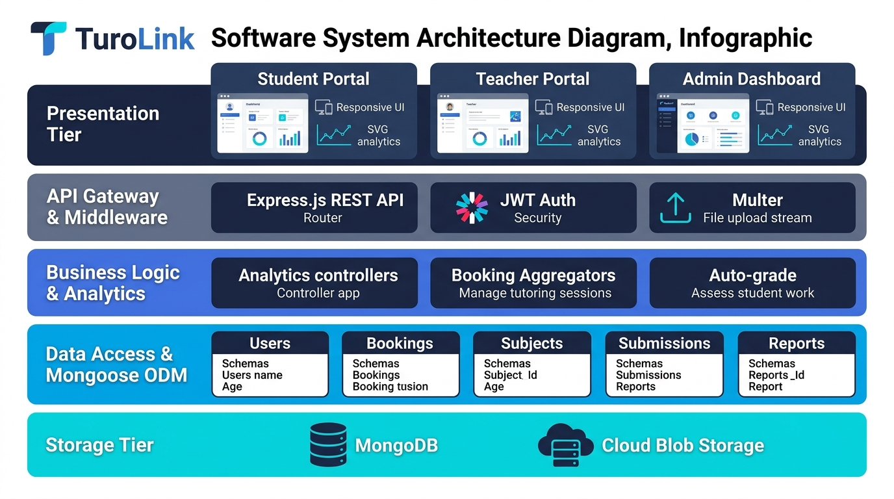
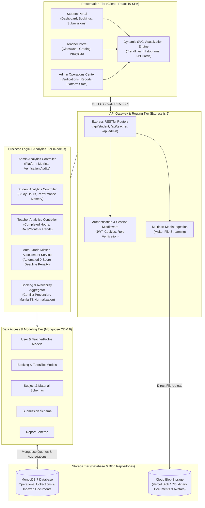
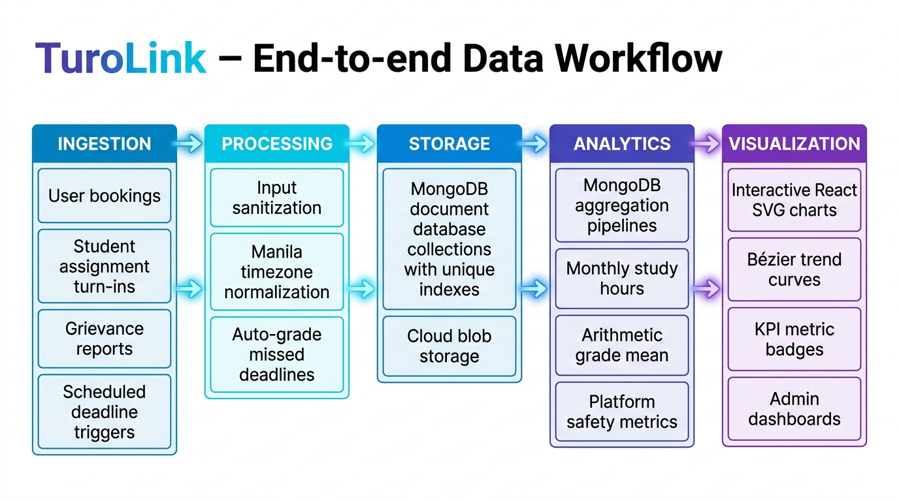

# TuroLink: Dataset, Data Preparation, and Analytics Implementation Report

---

## 2. DATASET AND DATA PREPARATION

### 2.1 Data Sources
The TuroLink platform collects and processes primary operational, academic, and transactional data generated directly through platform interactions between students, tutors, and system administrators. The primary storage engine is MongoDB, managed through Mongoose object-data modeling (ODM).

| Dataset | Source | Records | Purpose |
| :--- | :--- | :--- | :--- |
| **User Profiles (`users`)** | Direct user registration, Google OAuth 2.0 authentication, and administrative role assignment | All registered students, tutors, and platform administrators | Authentication, access authorization, role-based workflows, contact communication, and user lifecycle tracking. |
| **Tutor Credentials (`teacherprofiles`)** | Instructor onboarding applications, CV/credential submissions, and admin verification logs | Registered instructors applying for or granted teaching privileges | Verifying instructor qualifications, hourly rate benchmarking, subject specializations, and professional accreditation. |
| **Tutoring Sessions (`bookings`)** | Direct interactive scheduling and booking transactions between students and verified tutors | All reserved, confirmed, and completed 1-hour tutoring appointments | Managing calendar availability, logging lesson durations, session attendance, transactional pricing, and gathering multi-aspect student ratings. |
| **Curricula & Coursework (`subjects`)** | Course creation and classroom materials published by verified instructors | Subjects, syllabus units, announcements, and coursework materials (assignments, quizzes) | Structuring academic syllabi, publishing classroom announcements, distributing instructional materials, and establishing assignment submission deadlines. |
| **Student Submissions (`submissions`)** | Student coursework submissions (file attachments, notes) and automated deadline assessment service | All student submissions, graded evaluation entries, teacher feedback, and automated deadline records | Monitoring student assignment turn-in rates, logging grades and qualitative instructor feedback, tracking late work, and calculating academic mastery. |
| **Platform Incident Reports (`reports`)** | Community incident reporting submitted by active students and teachers | Incident dispute tickets (fraud, fake profile, harassment, scam, inappropriate content) | Platform safety enforcement, trust and safety monitoring, administrative grievance investigation, and account ban/moderation decisions. |

---

### 2.2 Data Description
The core entities within the TuroLink ecosystem utilize strongly typed schemas with validation constraints:

| Field | Description | Data Type |
| :--- | :--- | :--- |
| `User._id` | Unique identifier for each system user account | `ObjectId` |
| `User.name` | Legal full name of the student, tutor, or administrator | `String` |
| `User.email` | Normalized, unique email address used for credentials and notifications | `String` (lowercase, unique) |
| `User.phone` | Contact phone number for SMS and booking verification | `String` |
| `User.role` | Access control role (`'student'`, `'teacher'`, `'admin'`) | `String` (Enum) |
| `User.emailVerifiedAt` | Timestamp indicating when email verification was completed; null if unverified | `Date` / `Null` |
| `User.isBanned` | Administrative flag indicating account suspension due to policy violations | `Boolean` |
| `Booking.teacher` | Foreign key referencing the instructor for the scheduled session | `ObjectId` (Ref: `User`) |
| `Booking.student` | Foreign key referencing the student who booked the session | `ObjectId` (Ref: `User`) |
| `Booking.start` | Scheduled start time of the tutoring lesson (UTC) | `Date` |
| `Booking.end` | Scheduled end time of the tutoring lesson (UTC) | `Date` |
| `Booking.price` | Agreed hourly fee for the session in Philippine Peso (PHP) | `Number` |
| `Booking.status` | Booking lifecycle status (`'pending'`, `'confirmed'`) | `String` (Enum) |
| `Booking.review.rating` | Student post-session quantitative evaluation (scale: 1 to 5) | `Number` (Integer 1–5) |
| `Booking.review.aspects` | Granular ratings across teaching quality, communication, punctuality, and professionalism | `Object` (Integers 1–5) |
| `Subject.title` | Descriptive course title created by the instructor | `String` |
| `Subject.code` | Alphanumeric course code identifier (e.g., `"MATH101"`) | `String` |
| `Subject.enrolledStudents` | Array of student user identifiers actively enrolled in the subject | `Array<ObjectId>` |
| `Subject.materials.points` | Maximum possible points for an assignment or quiz (0–1000) | `Number` (min: 0, max: 1000) |
| `Subject.materials.dueAt` | Submission deadline timestamp; null if no deadline | `Date` / `Null` |
| `Subject.materials.allowLateSubmissions` | Toggle dictating whether work can be submitted past `dueAt` | `Boolean` |
| `Submission.status` | Submission state (`'submitted'`, `'graded'`) | `String` (Enum) |
| `Submission.grade` | Numeric score awarded by the teacher or system | `Number` (0–1000) |
| `Submission.isLate` | Flag indicating whether submission was received after the deadline | `Boolean` |
| `Submission.submittedAt` | Exact timestamp when student submitted work | `Date` |
| `Report.category` | Complaint taxonomy (`'fraud'`, `'fake_profile'`, `'harassment'`, `'scam'`, `'inappropriate_content'`, `'other'`) | `String` (Enum) |
| `Report.status` | Moderation status (`'pending'`, `'investigating'`, `'resolved'`, `'dismissed'`) | `String` (Enum) |
| `Report.actionTaken` | Disciplinary action executed (`'none'`, `'banned'`, `'warned'`, `'dismissed'`) | `String` (Enum) |

---

### 2.3 Data Preparation
Data preparation and hygiene in TuroLink are executed through automated database schema constraints, background cron/service tasks, and controller pipeline transformations:

#### 1. Missing-Value Handling
- **Academic Score Baseline**: When calculating student mastery percentages, if a material has null or zero points configured, the analytics engine defaults `maxPoints` to 100 to prevent division-by-zero runtime exceptions:
  ```javascript
  const maxPoints = Number(mat.points) > 0 ? Number(mat.points) : 100;
  const score = Number(sub.grade);
  const percentage = Math.min(100, Math.max(0, Math.round((score / maxPoints) * 100)));
  ```
- **Automated Grading of Unsubmitted Work**: The background auto-grade service (`autoGradeMissedMaterials`) proactively checks for students who missed strict deadlines (`allowLateSubmissions: false`). When a deadline passes without a submission, the service injects a zero-score record so missing values do not skew academic performance calculations:
  ```javascript
  if (!existingStudentIds.has(targetStudentId)) {
    newSubmissions.push({
      subjectId: subject._id,
      materialId: material._id,
      studentId: targetStudentId,
      status: 'graded',
      grade: 0,
      feedback: 'Automated: Deadline passed and late submissions are closed.',
      isLate: true,
      submittedAt: material.dueAt,
      gradedAt: now,
    });
  }
  ```
- **Null Safety in Aggregations**: Nullable rating and session records use fallback values (`row?.hours || 0`, `review?.rating || null`) during aggregate calculations.

#### 2. Duplicate Removal and Data Integrity Enforcement
- **Compound Unique Indexing**:
  - `schema.index({ teacher: 1, start: 1 }, { unique: true })`: Prevents scheduling double-bookings for teachers.
  - `schema.index({ student: 1, start: 1 }, { unique: true })`: Guarantees students cannot schedule overlapping sessions.
  - `submissionSchema.index({ materialId: 1, studentId: 1 }, { unique: true })`: Restricts each student to exactly one submission entry per coursework item.
- **Orphaned Profile Cleansing**: When querying teacher profiles for verification analytics, the admin pipeline identifies and purges orphaned profiles whose parent user accounts were previously deleted:
  ```javascript
  const allProfiles = await TeacherProfile.find().select('_id user').lean();
  const existingUsers = await User.find({ _id: { $in: userIds } }).select('_id role').lean();
  const existingUserMap = new Map(existingUsers.map(u => [String(u._id), u]));
  const orphanedIds = allProfiles.filter(p => !existingUserMap.get(String(p.user))).map(p => p._id);
  if (orphanedIds.length > 0) {
    await TeacherProfile.deleteMany({ _id: { $in: orphanedIds } });
  }
  ```

#### 3. Data Validation
- **Input Sanitization**: Email addresses are converted to lowercase and trimmed; report descriptions are trimmed and validated for minimum (5 chars) and maximum (3,000 chars) thresholds.
- **Self-Report Prevention**: The reporting controller rejects invalid inputs where a user reports themselves (`reporterId === reportedUserId`).
- **Whitelisted Categorization**: Category and role attributes must strictly match predefined enumerations:
  ```javascript
  const VALID_CATEGORIES = ['fraud', 'fake_profile', 'harassment', 'scam', 'inappropriate_content', 'other'];
  if (!category || !VALID_CATEGORIES.includes(category)) {
    return res.status(400).json({ message: 'Please select a valid report reason category.' });
  }
  ```

#### 4. Data Transformation
- **Timezone Adjustment**: Stored UTC timestamps are converted to Philippine Standard Time (`Asia/Manila`, UTC+8) for reporting periods and calendar grouping.
- **Duration Normalization**: Tutoring durations stored as `start` and `end` timestamps are converted into decimal hours via MongoDB's `$subtract` and `$divide` operators:
  ```javascript
  hours: { $sum: { $divide: [{ $subtract: ['$end', '$start'] }, 3600000] } }
  ```
- **Percentage Standardization**: All assignments and quizzes are normalized into a standardized percentage scale (0–100%) rounded to one decimal place to facilitate cross-subject comparison.

#### 5. Outlier Handling
- **Score Clamping**: Student score percentages are strictly clamped within the range `[0, 100]` using `Math.min(100, Math.max(0, ...))` to eliminate discrepancies caused by extra credit or faulty grade entry.
- **Duration Boundary Limits**: Booking slots are programmatically bounded to 1-hour durations (`(b.end - b.start) === 3600000 ms`), eliminating corrupted session records with negative or multi-day lengths.

---

## 3. ANALYTICS IMPLEMENTATION

### 3.1 Analytics Function 1 – Tutoring Session Hours & Engagement Trends
- **Purpose**:
  Determines a student’s and tutor’s total completed tutoring hours, monthly lesson volume, multi-month participation trajectory, and identifies peak engagement periods.
- **Method**:
  Time-series aggregation using MongoDB Aggregation Pipeline. Confirmed bookings within a rolling 6-month window are filtered, grouped by formatted calendar month (`$dateToString` with `Asia/Manila` timezone), and duration in milliseconds is summed and divided by $3,600,000$ to convert to hours. Descriptive metrics including total hours, average monthly hours, and peak engagement month are computed.
- **Input**:
  - Collection: `Booking`
  - Query Filters: `{ student: userId, status: 'confirmed', end: { $lte: now, $gte: sixMonthsAgo } }`
  - Fields: `start` (Date), `end` (Date), `status` (String)
- **Output**:
  - `sessionAnalytics`:
    - `totalHours`: Total completed tutoring hours over the 6-month period (e.g., `38.5` hrs).
    - `totalSessions`: Count of attended sessions (e.g., `38`).
    - `avgMonthlyHours`: Mean hours completed per month (e.g., `6.4` hrs/month).
    - `peakMonth`: Month with the highest tutoring volume (e.g., `"Oct"` with `14` hrs).
    - `monthly`: Chronological array of monthly objects `[{ month: 'May', hours: 4.0, sessions: 4 }, ...]`.
- **Interpretation**:
  Provides visibility into study commitment and learning continuity. An increasing trend reflects active examination preparation and topic engagement, while a steep decline alerts academic advisers to potential student disengagement or scheduling conflicts.

---

### 3.2 Analytics Function 2 – Student Academic Performance & Course Mastery Evaluation
- **Purpose**:
  Determines the student's overall academic average, subject-by-subject competence levels, score extremes (highest and lowest marks), and chronological progression across assignments and quizzes.
- **Method**:
  Relational data join and weighted arithmetic average algorithm. Enrolled subjects, curriculum materials, and graded submissions are cross-referenced. Each raw score is normalized against its assignment maximum points into a percentage. Chronological sorting yields trend progression, and arithmetic means are calculated across individual subjects and across all coursework.
- **Input**:
  - Collections: `Subject` (enrolled courses and materials subdocuments), `Submission`
  - Query Filters: `{ enrolledStudents: studentId }`, `{ studentId, status: 'graded' }`
  - Fields: `Submission.grade`, `Submission.gradedAt`, `Material.points`, `Material.type`, `Subject.title`
- **Output**:
  - `assessments.stats`:
    - `overallAverage`: Mean percentage score across all completed work (e.g., `87.4%`).
    - `highestScore`: Highest percentage achieved (e.g., `98%`).
    - `lowestScore`: Lowest percentage recorded (e.g., `65%`).
    - `totalGraded`: Total evaluated assignments (e.g., `14`).
    - `pendingGrading`: Work submitted awaiting evaluation (e.g., `2`).
  - `assessments.bySubject`: Breakdown containing `subjectId`, `code`, `title`, `averageScore`, and `gradedCount`.
  - `assessments.history`: Chronological array mapping grades over time for trend line plotting.
- **Interpretation**:
  Quantifies academic strengths and learning gaps. If a student exhibits a high overall average ($>85\%$) but shows low performance in a specific subject (e.g., $62\%$ in Physics), tutors can tailor upcoming 1-on-1 tutoring sessions to target weak competencies.

---

### 3.3 Analytics Function 3 – Platform Governance, Safety, & Complaint Resolution Analytics
- **Purpose**:
  Determines platform trust and safety health, incident category distribution (fraud, harassment, scam, fake accounts), administrative turnaround efficiency, and enforcement rates (account suspensions vs. dismissals).
- **Method**:
  Categorical aggregation and status segmentation. The system queries the `Report` and `User` collections, grouping incident tickets by processing status (`pending`, `investigating`, `resolved`, `dismissed`) and category, while tracking accounts sanctioned with bans (`isBanned: true`).
- **Input**:
  - Collections: `Report`, `User`
  - Query Filters: `{ status: { $in: ['pending', 'investigating', 'resolved', 'dismissed'] } }`, `{ isBanned: true }`
  - Fields: `Report.category`, `Report.status`, `Report.actionTaken`, `User.isBanned`, `Report.createdAt`
- **Output**:
  - `reportStats`:
    - `total`: Total filed complaints (e.g., `52`).
    - `pending`: Unreviewed incident reports (e.g., `4`).
    - `investigating`: Reports actively under review (e.g., `3`).
    - `resolved`: Successfully adjudicated complaints (e.g., `39`).
    - `dismissed`: Baseless or false complaints (e.g., `6`).
    - `bannedCount`: Malicious users permanently banned from TuroLink (e.g., `8`).
    - Category breakdown: Frequency counts for `'fraud'`, `'harassment'`, `'fake_profile'`, `'scam'`.
- **Interpretation**:
  Measures community safety and administrative responsiveness. A low ratio of `pending` to `total` tickets indicates high administrative vigilance. A high clustering of `'fake_profile'` reports triggers stricter identity verification requirements during tutor onboarding.

---

### 3.4 Summary of Analytical Results

| Analytics | Main Result | Interpretation | Decision/Action |
| :--- | :--- | :--- | :--- |
| **1. Tutoring Session & Engagement Analytics** | Identifies student monthly study hours (e.g., $6.4$ hrs/mo avg), completed sessions ($38$ total), and peak study months (e.g., October at $14$ hrs). | Demonstrates active learning spikes prior to midterm/final exams and highlights periods of student inactivity. | Allocate tutor capacity dynamically before peak exam months; trigger automated re-engagement reminders to inactive students. |
| **2. Student Performance & Mastery Analytics** | Computes cumulative percentage average ($87.4\%$), highest/lowest scores ($98\% / 65\%$), and subject-specific averages. | Evaluates curriculum mastery and highlights specific courses where the student struggles despite attending general tutoring. | Recommend specialized subject tutors to address weak topics; adjust instructional pacing for topics showing low completion averages. |
| **3. Safety & Complaint Resolution Analytics** | Tracks platform complaints by category, pending backlog ($4$ tickets), and permanent enforcement actions ($8$ banned accounts). | Evaluates platform risk distribution (predominantly fake profiles and payment scam attempts) and administrative turnaround time. | Ban confirmed fraudulent accounts immediately; implement stricter automated ID and certificate verification on tutor registration. |

---

## 4. SYSTEM DESIGN AND DATA WORKFLOW

### 4.1 System Architecture

#### Figure 1. System Architecture


*High-Resolution Vector SVG: [system_architecture.svg](diagrams/system_architecture.svg)*



#### Major Components Explanation

1. **Presentation Tier (Client)**:
   - Built as a responsive Single Page Application (SPA) using **React 19**, **Vite**, and **TailwindCSS**.
   - Modularized into dedicated role-based portals (Student, Teacher, and Administrator) with guarded route access ([ProtectedRoute.jsx](file:///d:/FinalProject/turolink/client/src/components/ProtectedRoute.jsx)).
   - Features built-in custom SVG analytical graphics engines ([StudentSessionHistoryGraph.jsx](file:///d:/FinalProject/turolink/client/src/components/StudentSessionHistoryGraph.jsx), [TeacherCompletedSessionsGraph.jsx](file:///d:/FinalProject/turolink/client/src/components/TeacherCompletedSessionsGraph.jsx)) that dynamically plot smooth Bézier trend lines, distribution histograms, and interactive data point tooltips without heavy external graphing libraries.

2. **API Gateway & Routing Tier (Express.js)**:
   - Implements **Express 5** to serve modular REST endpoints segregated by resource domains (`/api/auth`, `/api/student`, `/api/tutors`, `/api/admin`, `/api/reports`).
   - Handles security enforcement, JSON payload validation, CORS policies, JWT/session cookie verification, and role-based access control (RBAC).
   - Directs multipart form submissions and coursework file attachments through `multer` streaming.

3. **Business Logic & Analytics Tier (Node.js Services & Controllers)**:
   - Houses domain business rules, analytical computation routines, and background automation logic.
   - Contains specialized controllers ([studentController.js](file:///d:/FinalProject/turolink/server/controllers/studentController.js), [teacherController.js](file:///d:/FinalProject/turolink/server/controllers/teacherController.js), [adminController.js](file:///d:/FinalProject/turolink/server/controllers/adminController.js)) that run multi-step aggregation pipelines and in-memory statistical calculations.
   - Executes the [autoGradeService](file:///d:/FinalProject/turolink/server/services/autoGradeService.js) cron/pipeline, proactively identifying missed assignment deadlines and enforcing objective grading policies.

4. **Data Access & Modeling Tier (Mongoose ODM)**:
   - Enforces strict data models, field-level validations, default values, and schema indexing.
   - Enforces compound unique constraints to eliminate duplicate bookings (`{ teacher: 1, start: 1 }`) and submissions (`{ materialId: 1, studentId: 1 }`).
   - Manages relational document hydration through `.populate()` and executes automated cascade cleanup on orphaned profiles and session records.

5. **Storage Tier (MongoDB & Cloud Blob Storage)**:
   - **MongoDB 7**: Serves as the primary ACID-compliant, document-oriented operational datastore housing user accounts, subjects, bookings, submissions, and complaints.
   - **Cloud Blob Storage (Vercel Blob / Cloudinary)**: Offloads binary file storage (student assignment documents, homework PDFs, profile pictures) away from the database server, storing secure URLs in database records.

---

### 4.2 Data Workflow

The TuroLink platform follows a structured end-to-end data lifecycle: **Ingestion → Processing → Storage → Analytics → Visualization**.

#### Figure 2. Data Workflow


*High-Resolution Vector SVG: [data_workflow.svg](diagrams/data_workflow.svg)*

```mermaid
flowchart LR
    subgraph S1 ["1. INGESTION"]
        direction TB
        A1["User Actions<br/>(Booking, Submissions, Reports)"]
        A2["Auth Payloads<br/>(Registration, OAuth)"]
        A3["Scheduled Cron Events<br/>(Deadline Checks)"]
    end

    subgraph S2 ["2. PROCESSING"]
        direction TB
        B1["Input Validation & Sanitization<br/>(Trimming, Bounds, Enums)"]
        B2["Timezone Normalization<br/>(Asia/Manila UTC+8)"]
        B3["Auto-Grading & Penalty Logic<br/>(Auto 0-grade on expired work)"]
    end

    subgraph S3 ["3. STORAGE"]
        direction TB
        C1["MongoDB 7 Document Store<br/>(Collections with Unique Indexes)"]
        C2["Cloud Blob Storage<br/>(Assignment Files & Media)"]
    end

    subgraph S4 ["4. ANALYTICS"]
        direction TB
        D1["Aggregation Pipelines<br/>($match, $group, $subtract, $divide)"]
        D2["Statistical Arithmetic<br/>(Mean, Peak Detection, Clamping)"]
    end

    subgraph S5 ["5. VISUALIZATION"]
        direction TB
        E1["Interactive SVG Vector Charts<br/>(Bézier Trendlines & Histograms)"]
        E2["KPI Metric Cards & Badges<br/>(Counts, Averages, Ratios)"]
    end

    S1 ==>|HTTPS REST Request| S2
    S2 ==>|Mongoose Persistence| S3
    S3 ==>|Pipeline Query| S4
    S4 ==>|JSON Response Payload| S5
```



#### Detailed Stage-by-Stage Workflow

1. **Ingestion**:
   - Data enters the system via user interactions across client forms (student booking requests, student coursework submissions with file attachments, tutor availability slots, and dispute incident reports).
   - Ingestion also occurs via background automated triggers (scheduled cron and on-demand triggers invoking deadline checks for published coursework).
   - Requests are packaged as JSON payloads or `multipart/form-data` and transmitted over secure HTTPS via Axios client instances.

2. **Processing**:
   - **Validation & Sanitization**: Incoming requests pass through Express middleware to ensure authentication tokens are valid, string inputs are trimmed, text lengths adhere to constraints (e.g., 5 to 3,000 characters for complaints), and categories match whitelisted enums.
   - **Business Rules Enforcement**: Double-booking conflicts are caught and blocked; duplicate submissions are rejected; student self-reporting is blocked.
   - **Timezone Adjustment**: Stored timestamps are reconciled with Philippine Standard Time (`Asia/Manila`, UTC+8) to prevent date-boundary shifting.
   - **Automated Deadline Processing**: If an assignment deadline has expired and `allowLateSubmissions` is false, `autoGradeService` generates zero-score submissions before analytics calculation.

3. **Storage**:
   - Cleaned, validated records are written to MongoDB collections (`users`, `bookings`, `subjects`, `submissions`, `reports`, `authsessions`).
   - Database indexes guarantee uniqueness and prevent race conditions (e.g., duplicate time slots).
   - File binaries (homework PDFs, project archives) are stored in cloud object storage, and returned public/signed URLs are saved in document fields.

4. **Analytics**:
   - When dashboards are requested, specialized controller queries execute MongoDB multi-stage Aggregation Pipelines:
     - Aggregating completed booking durations: `{ $group: { _id: '$month', hours: { $sum: { $divide: [...] } } } }`.
     - Grouping complaint statuses: `{ $group: { _id: '$status', count: { $sum: 1 } } }`.
   - In-memory algorithms calculate summary metrics: overall arithmetic grade mean, highest/lowest marks, peak monthly tutoring hours, submission turn-in fulfillment rates, and resolution turnaround times.
   - Scores are mathematically normalized into standard 0–100 percentage values.

5. **Visualization**:
   - The computed analytics are bundled into a cohesive JSON response and returned to the client.
   - React state hooks (`useState`, `useEffect`) ingest the analytical metrics and drive dynamic visual components.
   - Vector graphics engines calculate coordinate geometry in real time to render:
     - Scaled vertical bar charts representing monthly study/teaching hours.
     - Smooth cubic Bézier polynomial spline curves showing performance trajectories over time.
     - Interactive hover tooltips displaying date, hour breakdowns, and session counts.
     - Color-coded KPI metric cards and badges for administrative decision-making.

---

### 4.3 Technologies Used

| Component | Technology | Purpose |
| :--- | :--- | :--- |
| **Frontend** | **React 19.2** & **Vite 8.3** | Delivers an ultra-responsive, component-based Single Page Application (SPA) architecture with fast HMR (Hot Module Replacement) and optimized production bundles. |
| **Frontend Styling** | **TailwindCSS 4.3** & **Lucide React** | Implements a modern, responsive design system with cohesive color palettes, dark/light visual states, and iconography across all user portals. |
| **Client Routing & Networking** | **React Router 7.18** & **Axios 1.20** | Manages browser navigation, role-protected client routes, and asynchronous REST API communications with automatic credentials handling. |
| **Backend Framework** | **Node.js** & **Express 5.2** | Powers the core server-side runtime and RESTful API gateway, managing routing, middleware authentication, rate limiting, and business domain logic. |
| **Authentication & Security** | **JWT**, **Bcrypt.js 3.0**, & **Google Auth Library 11.1** | Provides secure password hashing (salt rounds), stateless JSON Web Token session management, and OAuth 2.0 single sign-on authentication. |
| **Database & ODM** | **MongoDB 7.6** & **Mongoose 9.10** | Document-oriented NoSQL database providing high-throughput storage, flexible document schemas, compound index enforcement, and robust aggregation pipelines. |
| **Cloud Storage** | **Vercel Blob 2.8** & **Cloudinary 2.11** | Scalable cloud storage for persisting and serving student coursework attachments, syllabus files, and user profile images. |
| **Analytics Engine** | **MongoDB Aggregation Framework** & **Node.js Math Routines** | Executes server-side time-series data aggregation (`$match`, `$group`, `$dateToString`, `$divide`), statistical summarization, deadline auditing, and percentage normalization. |
| **Visualization Engine** | **Custom React SVG Vector Graphics Engine** & **CSS Animation** | Computes mathematical SVG path coordinates, cubic Bézier spline trendlines, and interactive proportional bar charts natively in the browser without third-party graphing bloat. |

